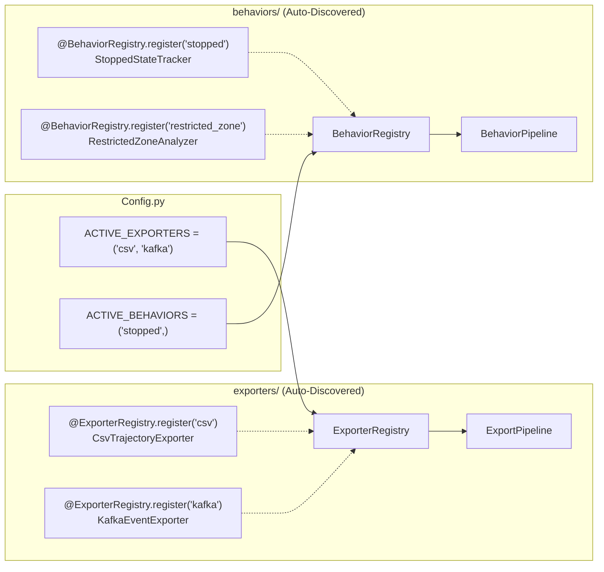

# SmartBuildings — High-Performance Multi-Camera Surveillance, Re-ID & Behavioral Analytics

## Visão Geral (Overview)

O **SmartBuildings** é uma plataforma de visão computacional em tempo real projetada para monitoramento inteligente de múltiplos ambientes, **Re-Identificação Global entre Câmeras (Cross-Camera Re-ID)**, análise comportamental extensível (*Stopped/Loitering*, *Restricted Zone*, etc.), exportação multi-destino (*CSV*, *Apache Kafka*, etc.) e **Análise Preditiva de Fluxo via Cadeias de Markov (MCMC)**.

O sistema segue rigorosamente os princípios **S.O.L.I.D.**, **Clean Architecture** e **Gang of Four (GoF) Design Patterns**, mantendo duas regras estritas de engenharia de software em todo o código:
1. **No máximo 1 classe por ficheiro (`.py`)**.
2. **No máximo 20 linhas por função ou método**.

Combinado com o motor de inferência em lote acelerado por **CUDA Graphs (FP16)**, **Torchvision (`roi_align`, `nms`, `box_iou`, `mobilenet_v3_small`)**, **`deep-sort-realtime`** e **`scipy` (`cdist`, `DisjointSet`)**, o sistema entrega **110+ FPS por câmera (220+ FPS agregados)** com alta precisão de detecção e Re-ID.

---

## Arquitetura de Pastas (Modular & S.O.L.I.D.)

O projeto está dividido em pacotes especializados por responsabilidade, tornando imediata a localização ou adição de qualquer funcionalidade:

```text
SmartBuildings/
├── main.py                                  # Ponto de entrada da aplicação
├── Config.py                                # Configurações centralizadas (ACTIVE_BEHAVIORS, ACTIVE_EXPORTERS, etc.)
├── MarkovChain.py                           # Análise preditiva de fluxo via MCMC (PyMC + NetworkX + Seaborn)
│
├── domain/                                  # ENTIDADES & VALUE OBJECTS DE DOMÍNIO (1 classe por ficheiro)
│   ├── BoundingBox.py                       # Value Object de caixa delimitadora [x1, y1, x2, y2]
│   ├── FramePacket.py                       # Value Object de frame decodificado e metadados
│   ├── TrackContext.py                      # Contexto passado aos plugins de comportamento a cada frame
│   ├── BehaviorResult.py                    # Resultado padronizado retornado por qualquer plugin de comportamento
│   ├── AnnotationSpec.py                    # Especificação visual (label + cor BGR) para renderização no HUD
│   └── GlobalIdentity.py                    # Entidade de identidade global (EMA + Galeria multi-pose + Histórico)
│
├── interfaces/                              # CONTRATOS / PORTAS ABC (Interface Segregation & Dependency Inversion)
│   ├── IFrameCommand.py                     # Contrato Command para captura de frames (RTSP, MP4, Kafka)
│   ├── ICommandFactory.py                   # Contrato Abstract Factory para criação de comandos entre processos
│   ├── IBehaviorAnalyzer.py                 # Contrato Strategy/Plugin para analisadores comportamentais
│   ├── IDataExporter.py                     # Contrato Strategy/Sink para exportadores de dados (CSV, Kafka, DB, API)
│   ├── IIdentityRepository.py               # Contrato Repository para o gerenciador de identidades globais
│   └── IStateTracker.py                     # Contrato para avaliação de estado de movimento/parada
│
├── behaviors/                               # PLUGINS DE COMPORTAMENTO (Auto-Discovery Registry Pattern, ZERO if/else)
│   ├── BehaviorRegistry.py                  # Registo dinâmico via decorator @BehaviorRegistry.register("nome")
│   ├── BehaviorPipeline.py                  # Pipeline Composite que executa os plugins ativos em Config.ACTIVE_BEHAVIORS
│   ├── StoppedStateTracker.py               # @BehaviorRegistry.register("stopped") - Detecção de pessoa parada
│   └── RestrictedZoneAnalyzer.py            # @BehaviorRegistry.register("restricted_zone") - Alerta de zona restrita
│
├── exporters/                               # EXPORTADORES DE DADOS (Auto-Discovery Registry Pattern, ZERO if/else)
│   ├── ExporterRegistry.py                  # Registo dinâmico via decorator @ExporterRegistry.register("nome")
│   ├── ExportPipeline.py                    # Pipeline Composite que formata e despacha eventos em tempo real e no encerramento
│   ├── CsvTrajectoryExporter.py             # @ExporterRegistry.register("csv") - Exportação analítica para CSV
│   └── KafkaEventExporter.py                # @ExporterRegistry.register("kafka") - Publicação JSON em tópico Kafka
│
├── identity/                                # RE-IDENTIFICAÇÃO GLOBAL & TOPOLOGIA DE CÂMERAS
│   ├── GlobalIdentityManager.py             # Serviço de Re-ID intra/inter-câmera e consolidação provisória
│   ├── CameraClusterManager.py              # Agrupamento automático de câmeras via scipy.cluster.hierarchy.DisjointSet
│   ├── IdentityManagerServer.py             # Servidor RPC BaseManager (modo multiprocess)
│   └── runtime_setup.py                     # Configuração de threads nativas (OpenCV/PyTorch) e flags CUDA/TF32
│
├── extraction/                              # CAPTURA ASSÍNCRONA DE VÍDEO (Command + Factory + Invoker)
│   ├── FrameReaderManagement.py             # Orquestrador do pipeline duplo-bufferizado GPU/CPU
│   ├── CameraProcess.py                     # Worker de processo isolado (modo multiprocess)
│   └── frameReaderCommand/
│       ├── FrameReaderInvoker.py            # Thread de captura assíncrona (mantém sempre o frame mais recente)
│       ├── ReadRTSPCommand.py               # Leitura de streams RTSP e vídeos locais (.mp4)
│       ├── ReadKafkaCommand.py              # Consumo de frames de vídeo via Apache Kafka
│       ├── RTSPCommandFactory.py            # Fábrica serializável para ReadRTSPCommand
│       └── KafkaCommandFactory.py           # Fábrica serializável para ReadKafkaCommand
│
├── vision/                                  # VISÃO COMPUTACIONAL, YOLO26n, RE-ID & DEEPSORT
│   ├── BatchInferenceEngine.py              # Motor em lote (CUDA Graphs + YOLO26n + Torchvision NMS/ROI-Align + MobileNetV3)
│   ├── GraphSlot.py                         # Buffers estáticos de GPU e memória Pinned duplo-bufferizada
│   ├── featureExtractor.py                  # Extrator Re-ID 576D (MobileNetV3 + Gray-World White-Balance Color Stripes)
│   ├── cameraWorker.py                      # Worker por câmera integrando `deep-sort-realtime`, Re-ID e BehaviorPipeline
│   └── StabilizedTrack.py                   # Subclasse de `deep_sort_realtime.deep_sort.track.Track` com amortecimento de oclusão
│
└── ui/                                      # CAMADA DE APRESENTAÇÃO
    └── display.py                           # Renderizador OpenCV (janelas individuais ou grade unificada a 60Hz)
```

---

## Padrões de Projeto (Design Patterns) & Escalabilidade sem `if/else`

Para permitir adicionar **100+ novos tipos de exportação** (CSV, Kafka, PostgreSQL, MongoDB, REST Webhook, WebSocket, etc.) ou **100+ novos analisadores de comportamento** sem criar cadeias de `if/else`, o sistema utiliza o **Self-Registering Plugin Registry Pattern com Auto-Discovery (`pkgutil.iter_modules`)**:



### Como Adicionar um Novo Exportador 

1. Crie um novo ficheiro dentro de [`exporters/`](file:///home/gabriel/Documents/vscode/python/SmartBuildings/exporters/) (por exemplo, `exporters/WebhookExporter.py`) com `@ExporterRegistry.register("webhook")`:
   ```python
   from exporters.ExporterRegistry import ExporterRegistry
   from interfaces.IDataExporter import IDataExporter

   @ExporterRegistry.register("webhook")
   class WebhookExporter(IDataExporter):
       @classmethod
       def from_config(cls, config) -> "WebhookExporter":
           return cls()

       def on_event(self, event: dict) -> None:
           # Chamado em tempo real a cada evento (opcional)
           pass

       def export(self, records: list[dict]) -> None:
           # Chamado com todos os registos consolidados
           pass
   ```
2. Ative-o em [`Config.py`](file:///home/gabriel/Documents/vscode/python/SmartBuildings/Config.py#L56-L60) adicionando `"webhook"` à tupla `ACTIVE_EXPORTERS`:
   ```python
   ACTIVE_EXPORTERS = ("csv", "kafka", "webhook")
   ```
   O `ExporterRegistry` descobre automaticamente o ficheiro na pasta `exporters/` via `pkgutil.iter_modules` — **nenhum outro ficheiro do projeto precisa ser editado!**

### Como Adicionar uma Nova Funcionalidade de Comportamento 

1. Crie um novo ficheiro dentro de [`behaviors/`](file:///home/gabriel/Documents/vscode/python/SmartBuildings/behaviors/) decorado com `@BehaviorRegistry.register("meu_alerta")` implementando `IBehaviorAnalyzer`.
2. Adicione `"meu_alerta"` em `ACTIVE_BEHAVIORS = ("stopped", "meu_alerta")` no [`Config.py`](file:///home/gabriel/Documents/vscode/python/SmartBuildings/Config.py#L38-L45).
   O rótulo do HUD, a cor da caixa e a exportação de eventos funcionarão automaticamente.

---

## Como Executar

```bash
# 1. Executar o sistema principal de rastreamento e Re-ID
./venv/bin/python main.py

# 2. Executar a análise preditiva de fluxo (Markov Chain MCMC)
./venv/bin/python MarkovChain.py
```
