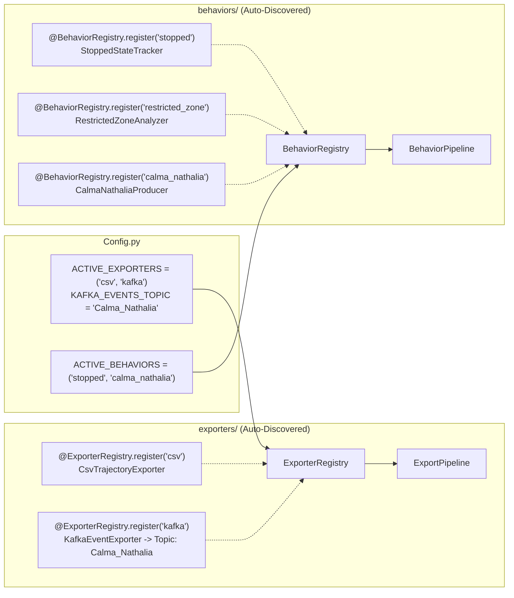

# SmartBuildings — High-Performance Multi-Camera Surveillance, Re-ID, Kafka Telemetry (`Calma_Nathalia`) & Behavioral Analytics

## Visão Geral (Overview)

O **SmartBuildings** é uma plataforma de visão computacional em tempo real projetada para monitoramento inteligente de múltiplos ambientes, **Re-Identificação Global entre Câmeras (Cross-Camera Re-ID)**, análise comportamental extensível (*Stopped/Loitering*, *Restricted Zone*, *Calma_Nathalia Telemetry Producer*, etc.), transmissão em tempo real de **toda a telemetria do YOLO e DeepSort para o Apache Kafka no tópico `"Calma_Nathalia"`**, exportação analítica para *CSV* e **Análise Preditiva de Fluxo via Cadeias de Markov (MCMC)**.

O sistema segue rigorosamente os princípios **S.O.L.I.D.**, **Clean Architecture** e **Gang of Four (GoF) Design Patterns**, mantendo duas regras estritas de engenharia de software em todo o código:
1. **No máximo 1 classe por ficheiro (`.py`)**.
2. **No máximo 20 linhas por função ou método**.

Combinado com o motor de inferência em lote acelerado por **CUDA Graphs (FP16)**, **Torchvision (`roi_align`, `nms`, `box_iou`, `mobilenet_v3_small`)**, **`deep-sort-realtime`** e **`scipy` (`cdist`, `DisjointSet`)**, o sistema entrega **110+ FPS por câmera (220+ FPS agregados)** com alta precisão de detecção e Re-ID.

---

## Arquitetura de Pastas (Modular & S.O.L.I.D.)

O projeto está dividido em pacotes especializados por responsabilidade, tornando imediata a localização ou adição de qualquer funcionalidade:

```text
SmartBuildings/
├── main.py                                  # Ponto de entrada da aplicação
├── Config.py                                # Configurações centralizadas (KAFKA_EVENTS_TOPIC = "Calma_Nathalia", etc.)
├── MarkovChain.py                           # Análise preditiva de fluxo via MCMC (PyMC + NetworkX + Seaborn)
│
├── domain/                                  # ENTIDADES & VALUE OBJECTS DE DOMÍNIO (1 classe por ficheiro)
│   ├── BoundingBox.py                       # Value Object de caixa delimitadora [x1, y1, x2, y2]
│   ├── FramePacket.py                       # Value Object de frame decodificado e metadados
│   ├── TrackContext.py                      # Contexto enriquecido com 100% dos dados do YOLO, DeepSort, Câmera e Limiares (%)
│   ├── BehaviorResult.py                    # Resultado padronizado retornado pelos plugins (inclui payload `telemetry`)
│   ├── AnnotationSpec.py                    # Especificação visual (label + cor BGR) para renderização no HUD
│   └── GlobalIdentity.py                    # Entidade de identidade global (EMA + Galeria multi-pose + Histórico)
│
├── interfaces/                              # CONTRATOS / PORTAS ABC (Interface Segregation & Dependency Inversion)
│   ├── IFrameCommand.py                     # Contrato Command para captura de frames (RTSP, MP4, Kafka)
│   ├── ICommandFactory.py                   # Contrato Abstract Factory para criação de comandos entre processos
│   ├── IBehaviorAnalyzer.py                 # Contrato Strategy/Plugin para analisadores comportamentais
│   ├── IDataExporter.py                     # Contrato Strategy/Sink para exportadores de dados (CSV, Kafka, DB, API)
│   ├── IIdentityRepository.py               # Contrato Repository para o gerenciador de identidades globais
│   └── IStateTracker.py                     # Contrato para avaliação de estado de movimento/parada
│
├── behaviors/                               # PLUGINS DE COMPORTAMENTO (Auto-Discovery Registry Pattern, ZERO if/else)
│   ├── BehaviorRegistry.py                  # Registo dinâmico via decorator @BehaviorRegistry.register("nome")
│   ├── BehaviorPipeline.py                  # Pipeline Composite que executa os plugins ativos em Config.ACTIVE_BEHAVIORS
│   ├── StoppedStateTracker.py               # @BehaviorRegistry.register("stopped") - Detecção de pessoa parada
│   ├── RestrictedZoneAnalyzer.py            # @BehaviorRegistry.register("restricted_zone") - Alerta de zona restrita
│   └── Calma_NathaliaProducer.py            # @BehaviorRegistry.register("calma_nathalia") - Telemetria completa YOLO+DeepSort
│
├── exporters/                               # EXPORTADORES DE DADOS (Auto-Discovery Registry Pattern, ZERO if/else)
│   ├── ExporterRegistry.py                  # Registo dinâmico via decorator @ExporterRegistry.register("nome")
│   ├── ExportPipeline.py                    # Pipeline Composite que formata e despacha eventos em tempo real e no encerramento
│   ├── CsvTrajectoryExporter.py             # @ExporterRegistry.register("csv") - Exportação analítica para CSV
│   └── KafkaEventExporter.py                # @ExporterRegistry.register("kafka") - Publicação JSON no tópico "Calma_Nathalia"
│
├── identity/                                # RE-IDENTIFICAÇÃO GLOBAL & TOPOLOGIA DE CÂMERAS
│   ├── GlobalIdentityManager.py             # Serviço de Re-ID intra/inter-câmera e enriquecimento de telemetria
│   ├── CameraClusterManager.py              # Agrupamento automático de câmeras via scipy.cluster.hierarchy.DisjointSet
│   ├── IdentityManagerServer.py             # Servidor RPC BaseManager (modo multiprocess)
│   └── runtime_setup.py                     # Configuração de threads nativas (OpenCV/PyTorch) e flags CUDA/TF32
│
├── extraction/                              # CAPTURA ASSÍNCRONA DE VÍDEO (Command + Factory + Invoker)
│   ├── FrameReaderManagement.py             # Orquestrador do pipeline duplo-bufferizado GPU/CPU
│   ├── CameraProcess.py                     # Worker de processo isolado (modo multiprocess)
│   └── frameReaderCommand/
│       ├── FrameReaderInvoker.py            # Thread de captura assíncrona (mantém sempre o frame mais recente)
│       ├── ReadRTSPCommand.py               # Leitura de streams RTSP e vídeos locais (.mp4)
│       ├── ReadKafkaCommand.py              # Consumo de frames de vídeo via Apache Kafka
│       ├── RTSPCommandFactory.py            # Fábrica serializável para ReadRTSPCommand
│       └── KafkaCommandFactory.py           # Fábrica serializável para ReadKafkaCommand
│
├── vision/                                  # VISÃO COMPUTACIONAL, YOLO26n, RE-ID & DEEPSORT
│   ├── BatchInferenceEngine.py              # Motor em lote (CUDA Graphs + YOLO26n + Classes COCO + MobileNetV3)
│   ├── GraphSlot.py                         # Buffers estáticos de GPU e memória Pinned duplo-bufferizada
│   ├── featureExtractor.py                  # Extrator Re-ID 576D (MobileNetV3 + Gray-World White-Balance Color Stripes)
│   ├── cameraWorker.py                      # Worker por câmera que monta `TrackContext` com métricas YOLO + DeepSort
│   └── StabilizedTrack.py                   # Subclasse de `Track` com extração completa de telemetria YOLO e Filtro de Kalman
│
└── ui/                                      # CAMADA DE APRESENTAÇÃO
    └── display.py                           # Renderizador OpenCV (janelas individuais ou grade unificada a 60Hz)
```

---

## Telemetria em Tempo Real no Apache Kafka — Tópico `"Calma_Nathalia"`

O sistema extrai **100% das informações disponíveis no YOLO26n e no DeepSort (`deep-sort-realtime` + Filtro de Kalman 8D)**, além da contagem de pessoas por câmera, classe do objeto, limiares percentuais e topologia Re-ID, publicando tudo em tempo real em formato JSON para o tópico Kafka **`"Calma_Nathalia"`** (configurado em [`Config.py`](file:///home/gabriel/Documents/vscode/python/SmartBuildings/Config.py#L56-L63)).

### Dados Extraídos do YOLO, DeepSort, Câmera e Limiares Percentuais

| Categoria | Campos Enviados para o Tópico `"Calma_Nathalia"` | Descrição |
| :--- | :--- | :--- |
| **Contagem na Câmera (`camera_summary`)** | `people_in_camera`, `total_tracks_in_camera`, `confirmed_tracks_in_camera`, `tentative_tracks_in_camera`, `coasting_tracks_in_camera`, `yolo_detections_in_camera`, `yolo_raw_candidates_in_camera`, `camera_fps`, `frame_number`, `frame_width`, `frame_height`, `camera_occupancy_pct` | Quantidade exata de pessoas ativas na câmera, total de tracks confirmados/tentativos/em oclusão, detecções brutas do YOLO, FPS da câmera e taxa percentual de ocupação. |
| **Classe do Objeto & YOLO (`yolo`)** | `object_class` (ex: `"person"`), `class_id` (ex: `0`), `confidence`, `confidence_pct`, `max_confidence`, `max_confidence_pct`, `bbox_xyxy`, `bbox_ltwh`, `raw_bbox_ltwh`, `center_xy`, `center_norm`, `width`, `height`, `area_px`, `area_pct`, `aspect_ratio`, `is_near_border`, `model_path` | Classe detectada pelo YOLO (`YOLO_TARGET_CLASSES`), confiança instantânea e máxima (em `[0..1]` e `%`), caixa suavizada e bruta, centro em pixels e normalizado `[0..1]`, área em pixels e `%` do frame, proporção (`w/h`) e proximidade de borda. |
| **Limiares Percentuais (`limiares_percentuais`)** | `yolo_confidence_pct`, `yolo_max_confidence_pct`, `yolo_margin_above_threshold_pct`, `bbox_frame_area_pct`, `deepsort_appearance_similarity_pct`, `camera_occupancy_pct`, `reid_similarity_pct`, `reid_distance_pct`, `yolo_conf_threshold_pct`, `yolo_init_conf_threshold_pct`, `yolo_conf_low_threshold_pct`, `yolo_iou_threshold_pct`, `deepsort_max_cosine_distance_pct`, `deepsort_max_iou_distance_pct`, `deepsort_nms_max_overlap_pct`, `reid_intra_camera_threshold_pct`, `reid_inter_camera_threshold_pct`, `reid_simultaneous_threshold_pct` | Todos os indicadores percentuais em tempo real comparados lado a lado com todos os limiares percentuais configurados do YOLO, DeepSort e Global Re-ID. |
| **DeepSort & Cinemática Kalman (`deepsort`)** | `local_track_id`, `global_id`, `track_state` (`"Confirmed"`/`"Tentative"`), `is_confirmed`, `is_tentative`, `hits`, `age`, `time_since_update`, `is_coasting`, `is_isolated`, `velocity_vx`, `velocity_vy`, `speed_px_per_frame`, `speed_px_per_sec`, `movement_direction_deg`, `kalman_mean_8d`, `kalman_bbox_ltrb`, `smoothed_bbox_ltrb`, `position_uncertainty`, `velocity_uncertainty`, `appearance_similarity_pct`, `embedding_dim`, `embedding_norm`, `gallery_size` | Estado interno completo do DeepSort e do Filtro de Kalman 8D (`[cx, cy, a, h, vx, vy, va, vh]`): velocidade em `px/frame` e `px/s`, ângulo de direção em graus, incerteza da matriz de covariância de posição/velocidade, similaridade de aparência (`%`) e tamanho da galeria. |
| **Global Re-ID & Topologia** | `global_id`, `camera_id`, `origin_camera`, `next_camera`, `ambiente_id`, `merged_cameras`, `cameras_path`, `reid_distance`, `reid_similarity_pct`, `duration_seconds`, `stopped_seconds` | Identidade global entre câmeras, cluster espacial (`Ambiente`), histórico de transição entre câmeras e tempo parado. |

### Exemplo Real de Payload JSON Publicado no Tópico `"Calma_Nathalia"`

```json
{
  "kafka_topic": "Calma_Nathalia",
  "event_type": "CALMA_NATHALIA_TELEMETRY",
  "global_id": 1,
  "camera_id": "cam_1",
  "origin_camera": "cam_1",
  "next_camera": "cam_1",
  "ambiente_id": "Ambiente_cam_1",
  "merged_cameras": "cam_1",
  "cameras_path": "cam_1",
  "people_in_camera": 6,
  "object_class": "person",
  "class_id": 0,
  "confidence_pct": 90.19,
  "reid_similarity_pct": 100.0,
  "duration_seconds": 1.25,
  "stopped_seconds": 0.0,
  "reid_distance": 0.0,
  "details": "Calma_Nathalia | Cam='cam_1' | Pessoas=6 (33.3%) | ID=1 (Local=1) | Classe='person' | Conf=90.2% | Vel=9.5px/s",
  "limiares_percentuais": {
    "yolo_confidence_pct": 90.19,
    "yolo_max_confidence_pct": 91.31,
    "yolo_margin_above_threshold_pct": 50.19,
    "bbox_frame_area_pct": 22.95,
    "deepsort_appearance_similarity_pct": 94.93,
    "camera_occupancy_pct": 33.33,
    "reid_similarity_pct": 100.0,
    "reid_distance_pct": 0.0,
    "yolo_conf_threshold_pct": 40.0,
    "yolo_init_conf_threshold_pct": 48.0,
    "yolo_conf_low_threshold_pct": 34.0,
    "yolo_iou_threshold_pct": 50.0,
    "deepsort_max_cosine_distance_pct": 40.0,
    "deepsort_max_iou_distance_pct": 72.0,
    "deepsort_nms_max_overlap_pct": 75.0,
    "reid_intra_camera_threshold_pct": 35.0,
    "reid_inter_camera_threshold_pct": 37.0,
    "reid_simultaneous_threshold_pct": 30.0
  },
  "camera_summary": {
    "camera_id": "cam_1",
    "people_in_camera": 6,
    "total_tracks_in_camera": 8,
    "confirmed_tracks_in_camera": 6,
    "tentative_tracks_in_camera": 2,
    "coasting_tracks_in_camera": 0,
    "yolo_detections_in_camera": 8,
    "yolo_raw_candidates_in_camera": 15,
    "camera_fps": 115.4,
    "frame_number": 42,
    "frame_width": 640,
    "frame_height": 480,
    "camera_occupancy_pct": 33.33
  },
  "yolo": {
    "object_class": "person",
    "class_id": 0,
    "confidence": 0.9019,
    "confidence_pct": 90.19,
    "max_confidence": 0.9131,
    "max_confidence_pct": 91.31,
    "bbox_xyxy": [432.15, 62.93, 602.38, 477.16],
    "bbox_ltwh": [432.15, 62.93, 170.23, 414.23],
    "raw_bbox_ltwh": [432.5, 63.25, 174.5, 413.75],
    "center_xy": [517.26, 270.04],
    "center_norm": [0.8082, 0.5626],
    "width": 170.23,
    "height": 414.23,
    "area_px": 70515.7,
    "area_pct": 22.95,
    "aspect_ratio": 0.411,
    "is_near_border": true,
    "model_path": "models/yolo26n.pt"
  },
  "deepsort": {
    "local_track_id": 1,
    "global_id": 1,
    "track_state": "Confirmed",
    "is_confirmed": true,
    "is_tentative": false,
    "hits": 18,
    "age": 18,
    "time_since_update": 0,
    "is_coasting": false,
    "is_isolated": true,
    "velocity_vx": 2.1136,
    "velocity_vy": 0.0682,
    "speed_px_per_frame": 2.1147,
    "speed_px_per_sec": 9.48,
    "movement_direction_deg": 1.85,
    "kalman_mean_8d": [518.8106, 270.0947, 0.4002, 413.9318, 2.1136, 0.0682, 0.0, -0.4091],
    "kalman_bbox_ltrb": [435.98, 63.13, 601.64, 477.06],
    "smoothed_bbox_ltrb": [432.15, 62.93, 602.38, 477.16],
    "position_uncertainty": 3156.9095,
    "velocity_uncertainty": 5959.2107,
    "appearance_similarity_pct": 94.93,
    "embedding_dim": 576,
    "embedding_norm": 1.0,
    "gallery_size": 12
  }
}
```

---

## Padrões de Projeto (Design Patterns) & Escalabilidade sem `if/else`

Para permitir adicionar **100+ novos tipos de exportação** (CSV, Kafka, PostgreSQL, MongoDB, REST Webhook, WebSocket, etc.) ou **100+ novos analisadores de comportamento** sem criar cadeias de `if/else`, o sistema utiliza o **Self-Registering Plugin Registry Pattern com Auto-Discovery (`pkgutil.iter_modules`)**:



### Como Usar Todos os Dados do YOLO e DeepSort em Qualquer Plugin (`TrackContext`)

Todo plugin em [`behaviors/`](file:///home/gabriel/Documents/vscode/python/SmartBuildings/behaviors/) recebe um objeto [`TrackContext`](file:///home/gabriel/Documents/vscode/python/SmartBuildings/domain/TrackContext.py) no método `analyze(self, track_context: TrackContext) -> BehaviorResult` com acesso direto a todos os atributos do YOLO, DeepSort, Câmera e Limiares Percentuais:

```python
from behaviors.BehaviorRegistry import BehaviorRegistry
from domain.BehaviorResult import BehaviorResult
from domain.TrackContext import TrackContext
from interfaces.IBehaviorAnalyzer import IBehaviorAnalyzer

@BehaviorRegistry.register("meu_alerta")
class MeuAlertaAnalyzer(IBehaviorAnalyzer):
    def analyze(self, track_context: TrackContext) -> BehaviorResult:
        pessoas = track_context.people_in_camera                         # Quantidade de pessoas na câmera
        classe = track_context.object_class                              # Classe detectada pelo YOLO (ex: "person")
        limiares = track_context.limiares_percentuais                    # Todos os limiares e métricas em %
        yolo_data = track_context.yolo_metrics                           # Dados completos do YOLO
        deepsort_data = track_context.deepsort_metrics                   # Dados completos do DeepSort e Kalman 8D
        payload_completo = track_context.to_telemetry_dict()             # Dicionário completo pronto para Kafka
        return BehaviorResult(
            name="meu_alerta",
            is_active=True,
            event_type="MEU_EVENTO",
            telemetry=payload_completo,
        )
```

---

## Como Executar

```bash
# 1. Executar o sistema principal (envia telemetria em tempo real para o tópico Kafka "Calma_Nathalia" e exporta CSV)
./venv/bin/python main.py

# 2. Executar a análise preditiva de fluxo (Markov Chain MCMC)
./venv/bin/python MarkovChain.py
```
